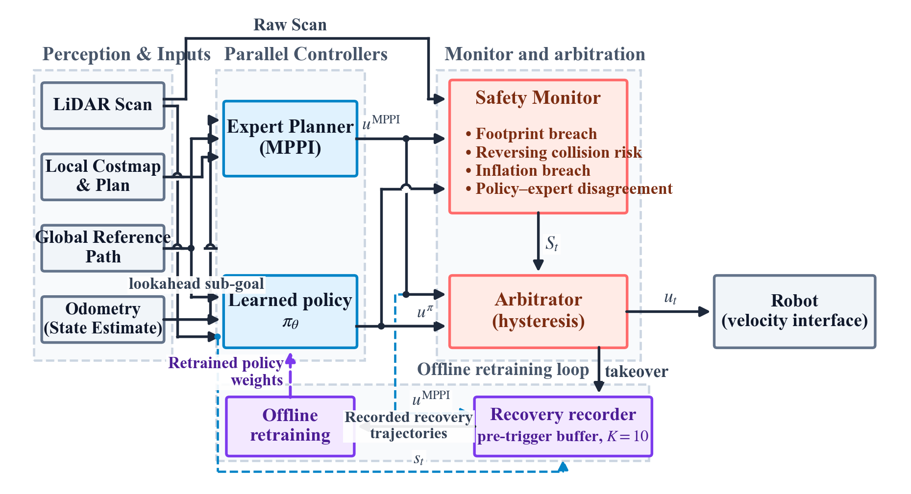

# Navigating the Shielding Paradox: Runtime Shared Autonomy for Safe Learning-Based Mobile Robot Navigation

[](paper/ICAIR_2026_Paper_93_Revised_Manuscript_Ikechukwu.pdf)
[](https://your-website.com/project)
[]()
[](https://docs.ros.org/en/humble/)
[](https://pytorch.org)
[](https://navigation.ros.org/)
[](https://onnx.ai/)

This repository contains the official implementation of the paper **"Navigating the Shielding Paradox: Runtime Shared Autonomy for Safe Learning-Based Mobile Robot Navigation"**, accepted at the **International Conference on Artificial Intelligence and Robotics (MIRG-ICAIR 2026)**.

---

## 📌 Abstract

Deploying learning-based navigation policies on mobile robots is challenging because covariate shift can lead to states poorly represented in training data, increasing the risk of collisions. This framework presents a runtime shared-autonomy architecture that arbitrates control between a learned navigation policy (Behavior Cloning / Safe DAgger) and a Nav2 Model Predictive Path Integral (MPPI) expert controller using geometric risk criteria and policy–expert disagreement. 

By retaining expert-labelled recovery windows including a 10-step ($1.0\text{ s}$) pre-trigger history for offline policy retraining, the retrained policy successfully matches the expert's completion rate across complex indoor environments. However, runtime evaluation also exposes the **"Shielding Paradox"**: while classical planner intervention prevents catastrophic boundary breaches, conservative costmap constraints can induce deadlocks in tight, cluttered spaces.

---

## 📄 Paper & Documentation

- **Accepted Manuscript:** [`paper/ICAIR_2026_Paper_93_Revised_Manuscript_Ikechukwu.pdf`](paper/ICAIR_2026_Paper_93_Revised_Manuscript_Ikechukwu.pdf)
- **Author:** Sunday Ikechukwu (*Department of Mechatronics Engineering, University of Benin*)
- **Venue:** International Conference on Artificial Intelligence and Robotics (MIRG-ICAIR 2026)

---

## 🔬 Reproducing Results (Traceability Matrix)
To reproduce the findings, tables, and figures from the paper, use the following mapping between the paper sections and repository code:
| Paper Artifact | Description | Corresponding Source / Script | Execution / Launch Entrypoint |
| :--- | :--- | :--- | :--- |
| **Table 1** | Monitor Trigger Rules & Disagreement Conditions | [`shielded_autonomy/safety_monitor_node_v2.py`](shielded_autonomy/safety_monitor_node_v2.py) | Active within `ros2 launch shielded_autonomy safe_dagger.launch.py` |
| **Table 2** | Training Datasets ($D_{\text{initial}}, D_{\text{rec,1}}, D_{\text{rec,2}}$) | [`shielded_autonomy/imitation_data_recorder_v2.py`](shielded_autonomy/imitation_data_recorder_v2.py), [`safe_dagger_recorder_node_v2.py`](shielded_autonomy/safe_dagger_recorder_node_v2.py) | Automatic logging during monitored takeovers |
| **Table 3** | Exp. A & B: Standalone Benchmark (BC $\pi_0$, RC-BC $\pi_1$, Final RC-B $\pi_2$, MPPI) | [`shielded_autonomy/policy_metrics_node.py`](shielded_autonomy/policy_metrics_node.py), [`bc_inference_node_v2.py`](shielded_autonomy/bc_inference_node_v2.py), [`safe_dagger_inference_node.py`](shielded_autonomy/safe_dagger_inference_node.py) | `ros2 run shielded_autonomy [bc\|safe_dagger]_inference_node --ros-args --remap /cmd_vel_bc:=/cmd_vel`<br>+ `ros2 run shielded_autonomy policy_metrics_node`<br>+ `python3 analysis/generate_tables.py` |
| **Table 4** | Exp. C: Runtime Shared Autonomy & Safety Interventions | [`shielded_autonomy/runtime_metrics_node.py`](shielded_autonomy/runtime_metrics_node.py), [`arbitration_node.py`](shielded_autonomy/arbitration_node.py), [`safety_monitor_node.py`](shielded_autonomy/safety_monitor_node.py) | `ros2 launch shielded_autonomy safe_dagger.launch.py`<br>+ `ros2 run shielded_autonomy runtime_metrics_node`<br>+ `python3 analysis/generate_tables.py` |
| **Figure 1** | Architecture: Monitored loop & recovery-centric data pipeline | Documented in `safety_monitor_node.py`, `arbitration_node.py`, & `safe_dagger_recorder_node.py` | — |
| **Figure 2** | Simulation Environments: Env A (Known) & Env B (Unknown) | [`worlds/experiment_b_world2.sdf`](worlds/experiment_b_world2.sdf), [`maps/`](maps/) | Included in `ros2 launch shielded_autonomy full_system.launch.py` |
| **Trajectory Paths** | Waypoint and Executed Path Logging | [`shielded_autonomy/export_nav2_paths.py`](shielded_autonomy/export_nav2_paths.py) | `python3 shielded_autonomy/export_nav2_paths.py` |

---

## 🛠️ System Architecture


1. **Learned Policy ($\pi_\theta$):** An MLP $[256, 128, 64]$ mapping a $40\text{D}$ observation (36 LiDAR beams, 2 odometry velocities, 2 local goal coordinates) to $[v, \omega]$. Executed at $10\text{ Hz}$ via ONNX Runtime.
2. **Safety Monitor:** Runs at $10\text{ Hz}$, evaluating 4 conditions: footprint breach ($< 0.22\text{ m}$), reversing collision risk ($< 0.25\text{ m}$), inflation breach ($< 0.35\text{ m}$), and angular/linear command disagreements ($|\Delta\omega| > 0.8\text{ rad/s}, |\Delta v| > 0.15\text{ m/s}$).
3. **Arbitrator:** Enforces a $3.0\text{ s}$ recovery cooldown timer ($T_{\text{rec}}$) and a $4.0\text{ s}$ deadlock detection watchdog ($T_{\text{deadlock}}$) with a $1.5\text{ s}$ unshielded shake-up window to avoid stagnation.
4. **Data Recorder:** Pre-trigger FIFO buffer of $K=10$ steps ($1.0\text{ s}$) preceding intervention paired with corrective MPPI expert commands.
---
## 💻 Installation & Dependencies
### Prerequisites
- **OS:** Ubuntu 22.04 LTS
- **ROS 2:** [Humble Hawksbill](https://docs.ros.org/en/humble/Installation.html)
- **Simulator:** Gazebo Classic 11
- **Platform:** TurtleBot3 Waffle
```bash
# 1. Install ROS 2 navigation and TurtleBot3 packages
sudo apt update
sudo apt install -y \
    ros-humble-navigation2 \
    ros-humble-nav2-bringup \
    ros-humble-turtlebot3 \
    ros-humble-turtlebot3-gazebo \
    ros-humble-turtlebot3-navigation2
# 2. Install Python dependencies
pip install -r requirements.txt
```
### Build Workspace
```bash
cd ~/nav2_ws/src
git clone https://github.com/sunday-ikechukwu/shielded-autonomy.git
cd ~/nav2_ws
colcon build --symlink-install --packages-select shielded_autonomy
source install/setup.bash
```

## 🚀 Quickstart & Usage
The evaluation workflow uses a multi-terminal setup:
1. **Terminal 1:** Bring up the simulation world, map localization, Nav2 MPPI stack, and RViz.
2. **Terminal 2:** Run the chosen policy, expert, or shared-autonomy arbitration stack.
3. **Terminal 3:** Run the corresponding evaluation metrics logger.
4. **Terminal 4:** Dispatch experimental scenario goals.
---
### Step 1: Launch Base Infrastructure (Simulation & Nav2 MPPI)
In your first terminal, launch Gazebo Classic, the TurtleBot3 Waffle platform, AMCL localization, the Nav2 MPPI controller, and RViz:
```bash
export TURTLEBOT3_MODEL=waffle
source ~/nav2_ws/install/setup.bash
ros2 launch shielded_autonomy full_system.launch.py
```
>[!NOTE] (Wait ~12 seconds for the staged startup timers to complete and for RViz to initialize.)

---
### Step 2: Choose Execution Mode (Experiments A, B, or C)

***Velocity Routing Note:**
- In **Shared Autonomy Mode (Exp. C)**, the policy publishes to `/cmd_vel_bc` and MPPI publishes to `/cmd_vel_mppi`. The `arbitration_node` arbitrates between them and publishes the chosen velocity to `/cmd_vel`.
- In **Standalone Policy Mode (Exp. A & B)**, you must remap `/cmd_vel_bc` to `/cmd_vel` so the policy directly commands the robot.
- In **Standalone MPPI Mode (Exp. A & B)**, you configure Nav2 to publish directly to `/cmd_vel`.

#### Option A: Standalone Learned Policy (Experiments A & B)
To evaluate the unmonitored policy under nominal conditions or zero-shot distribution shift:
```bash
source ~/nav2_ws/install/setup.bash
# --- Terminal 2: Run Inference Policy (remap /cmd_vel_bc to /cmd_vel) ---
# For Baseline Behavior Cloning (pi_0):
ros2 run shielded_autonomy bc_inference_node --ros-args --remap /cmd_vel_bc:=/cmd_vel
# OR for Final Retrained Policy (pi_2):
ros2 run shielded_autonomy safe_dagger_inference_node --ros-args --remap /cmd_vel_bc:=/cmd_vel
# --- Terminal 3: Record Standalone Benchmark Metrics ---
ros2 run shielded_autonomy policy_metrics_node
```

#### Option B: Standalone MPPI Expert Reference (Experiments A & B)
To run the classical Nav2 MPPI planner as the standalone benchmark:
1. Open `launch/navigation2_bringup_custom.launch.py`.
2. Under both `load_nodes` (lines 182–185) and `load_composable_nodes` (lines 243–246), uncomment the direct `/cmd_vel` mapping and `comment out` /cmd_vel_mppi:
```bash
# For Standalone MPPI:
remappings=remappings + [('cmd_vel', 'cmd_vel_nav'), ('cmd_vel_smoothed', 'cmd_vel')]
# remappings=remappings + [('cmd_vel', 'cmd_vel_nav'), ('cmd_vel_smoothed', 'cmd_vel_mppi')]
```
3. Re-build and source:
```bash
colcon build --symlink-install --packages-select shielded_autonomy
source install/setup.bash
```
4. Start the policy metrics node in Terminal 3:
```bash
ros2 run shielded_autonomy policy_metrics_node
```

#### Option C: Full Runtime Shared Autonomy Stack (Experiment C)
To evaluate the combined system where the safety monitor arbitrates control between the policy and MPPI expert, while automatically recording DAgger recovery trajectories:

>[!NOTE]
>(Ensure `navigation2_bringup_custom.launch.py` has `cmd_vel_smoothed` mapped back to `cmd_vel_mppi`)
```bash
source ~/nav2_ws/install/setup.bash
# --- Terminal 2: Launch Policy + Safety Monitor + Arbitrator + Recorder ---
ros2 launch shielded_autonomy safe_dagger.launch.py
# --- Terminal 3: Record Runtime Shared-Autonomy Metrics ---
ros2 run shielded_autonomy runtime_metrics_node
```

### Step 3: Dispatch Experimental Scenarios
Use `experiment/scenario_runner.py` to send deterministic start and goal poses:
```bash
source ~/nav2_ws/install/setup.bash
# List all available scenarios:
python3 experiment/scenario_runner.py --list --yaml experiment/experiment_A_scenarios.yaml
# Run Scenario A1 (Known Environment - Exp. A or C):
python3 experiment/scenario_runner.py A1 --yaml experiment/experiment_A_scenarios.yaml
# Run Scenario B1 (Unseen Environment - Exp. B or C):
python3 experiment/scenario_runner.py B1 --yaml experiment/experiment_B_scenarios.yaml
```

### Step 4: Analysis, Figures, & Path Export
Post-process recorded runs and generate the tables and figures from the paper:
```bash
# 1. Validate and consolidate recorded trial summaries:
python3 analysis/validate_results.py
python3 analysis/consolidate_results.py
# 2. Generate paper figures and tables (Figures A1, B1, C1 & Tables 3, 4, A1, B1):
python3 analysis/generate_figures.py
python3 analysis/generate_tables.py
# 3. Export executed Nav2 trajectory paths:
python3 shielded_autonomy/export_nav2_paths.py
```

## 📊 Citation
If you find this code or our paper useful in your research, please cite:
```bibtex
@inproceedings{ikechukwu2026shielded,
  title     = {Navigating the Shielding Paradox: Runtime Shared Autonomy for Safe Learning-Based Mobile Robot Navigation},
  author    = {Ikechukwu, Sunday},
  booktitle = {Proceedings of the International Conference on Artificial Intelligence and Robotics (MIRG-ICAIR 2026)},
  year      = {2026}
}
```